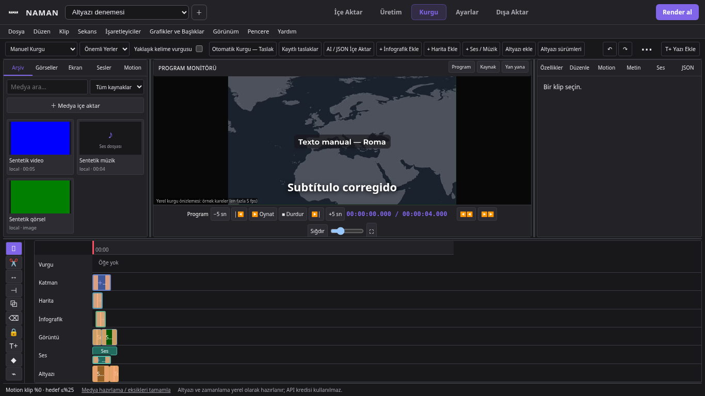
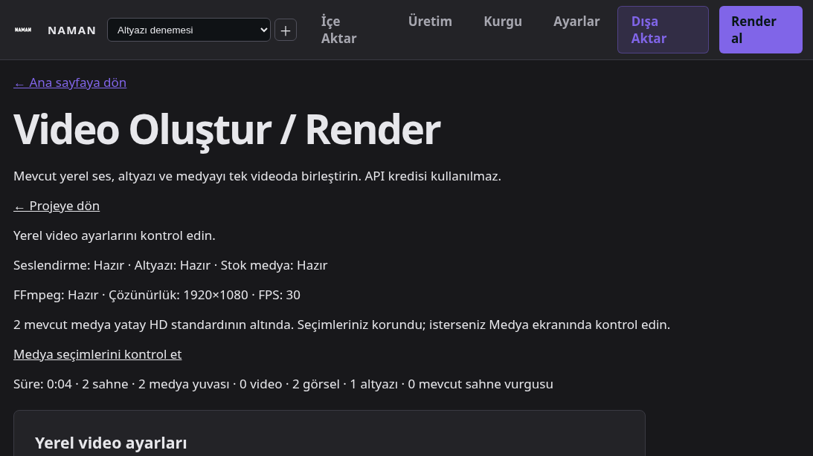

# NAMAN 2.0 — Manuel öncelikli kurgu teslim raporu

## 1. Başlangıç main commit'i

`f4fa91c57d5ba176dc4d33cbdcde8b32b7426025` — PR #91'in birleştiği güncel main temel alındı. PR #90 ve #91'in kodu bu dalın atalarıdır. Main'e birleştirme yapılmaz.

## 2. Geliştirme dalı

`feature/naman-manual-first-editor-overhaul`

## 3. Commitler

- `8173235` — yeni proje politikası, eklemeli veritabanı, güvenli boş yuva, manuel render temeli.
- `9a74eb8` — ortak geçmiş, kalıcı/kısmi onaylı taslaklar, yerel önizleme, kaynak/maliyet güvenliği, font ve ses doğrulamaları.
- `078e4a1` — eski MIME verisinde temel önizleme ve eski denetim önbelleği uyumluluğu.
- `4f28ea9` — manuel kurgu arayüzü; alt oynatma/dikey araçlar, altyazı/JSON/taslak ve Gemini panelleri, gerçek tarayıcı akışı.
- `b5d80ed` — geçersiz object_id alanını açıklayarak reddetme; yalnız dış kimliği değiştirilmiş aynı JSON içeriğinin tekrar içe alınmasını engelleme.
- `32398a7` — yalnız örnek motion kareleri için 240 dosyalık ayrı önbellek; gerçek arşiv/işaret/önce-sonra görsellerinin hash doğrulamalı önizleme testleri.
- `d4bd117` — ortak miks geçmişi testi; legacy stok kabulünün açık politikası ve uzun video üretmeyen çizici taklidiyle doğrulanması.
- Son rapor/kanıt commit'i GitHub karşılaştırmasının commit listesinde ve kullanıcıya verilen son teslimde belirtilir.

## 4. Gerçekten tamamlanan işlevler

“Var” aşağıdaki ortak model/API yolunun uygulandığını belirtir. Canlı ücretli servis veya Windows testinin yapılmış olduğu anlamına gelmez.

| İşlev | UI / API | Kalıcılık | Önizleme | Final render | Kanıt |
|---|---|---|---|---|---|
| Temel medya kaldırma / devre dışı bırakma | Delete, sağ tık ve dikey araç; ek belge API'si | Boş/devre dışı yuva + ortak geçmiş | Aynı saatte boş/siyah görüntü | Siyah kare; arşiv ve anlatım korunur | Gerçek kısa çıktı, sil/undo/redo/refill tarayıcı akışı |
| Ek medya/metin/vurgu/şekil | Seçim, çoklu ek klip seçimi, taşıma, trim, bölme, çoğaltma, güvenli kopyala/yapıştır, kilit | Proje + aktif plan + belge revizyonu | Ortak compositor; gerçek örnek kare | Aynı dönüşüm/efekt/keyframe graph'ı | PR #91 tarayıcı ve FFmpeg regresyonları |
| Yazı stilleri | T+; font/kalınlık/hizalama/satır genişliği/kutu/renk | Ek belge | Raster metin | Aynı raster metin | Beş fontta normal/kalın pikseller farklı; tarayıcıda kaydet/yeniden aç |
| Harita ve infografik | Mevcut motorun şablonları; veri/rengi/süresi; JSON ile tekrar düzenleme | Bağımsız uygun izde klip | Yerel tek kare | Yerel motion kaynağı + ortak graph | Temiz map testi, gerçek map/stat tarayıcı/render akışı |
| Temiz harita + ayrı işaret | `map` şablonunda temiz kaynak; bağımsız pin/ok/dikdörtgen | Ayrı nesneler | Başlık/pin/SFX'siz harita; işaretin ayrı transform/keyframe'i | Aynı nesneler | Harita sahnesinde dekor/etiket/pin/SFX bulunmadığı testi |
| Altyazı | Metin/zaman, ekle/sil/böl/birleştir/trim, önemli seçimi, sürümler ve SRT/VTT | Gerçek subtitle_versions/cues; eski sürümler saklanır | Aktif tek altyazı kaynağı | Aynı aktif sürümden ASS | Saat/sürüm/geçmiş testleri ve İspanyolca UI akışı |
| Tam / önemli / kapalı | Kurgu şeridi ve Render seçimi | Editorial politika | Seçilmiş cümleler veya kapalı | Aynı cümle filtresi | Backend + gerçek önemli-mod çıktı |
| Ses / müzik / SFX | Arşiv MP3/WAV; başlangıç/bitiş/seviye; özelliklerde fade, ses keyframe'i, hız, ducking | Ek ses klibi ve gerçek miks ayarları | Eşzamanlı oynatıcı; ducking yaklaşık RMS eşiği | FFmpeg sidechaincompress; timeline müziği global müziğe öncelikli | Gerçek ses/fade/keyframe ve ducking örnekleri; 4 sn çıktı |
| Ortak geri al / yinele | Üst kontrol, menü ve Ctrl+Z/Ctrl+Shift+Z | Belge/yuva/politika/altyazı/miks olayları | Yeniden yüklenen gerçek durum | Geri alınmış kayıt kullanılır | Alanlar arası geçmiş, onay/mod geri alma ve kısmi onay testleri |
| Otomatik kurgu | Yalnız açık komut; ayrı taslak | Kalıcı draft/approved olayları | Fark listesi + kaydetmeden gerçek kare | Yalnız onaylanan bağımsız nesneler | Onay öncesi belge değişmez; kısmi/tekrar/eski revizyon kontrolleri |
| AI / JSON | Beş bölüm, dosya/yapıştırma, doğrulama, fark/çakışma, seçili onay | Taslak + onaylı ek belge revizyonu | Kaydetmeden ortak kare | Onaylanan metin/motion/dönüşüm/geçişler | Geçerli/geçersiz JSON, sınır, tekrar, onay/undo |
| Gemini denetimi | Ayrı paylaşım/maliyet kutuları; kayıtlı rapor; git/seç/not/yok say/çözüldü | Video sürümü/hash kapsamlı önbellek ve bulgu durumları | Bulgu zamanına gitme; otomatik düzeltme yok | Kendiliğinden değişiklik yok; kullanıcı düzenlerse normal kayıt/render yolu | İzin/kapsam/önbellek testleri; sentetik kayıtlı rapor UI testi; canlı çağrı yapılmadı |

## 5. Önceden bulunan ve korunan işlevler

Kaynak/Program/yan yana monitörler, gerçek video thumbnail önbelleği, dosya bırakmayla güvenli içe aktarma, kaynak kesiti ile timeline zamanını ayırma, ek klip/efekt/keyframe/marker geçmişi, Wipe/Cross dissolve/Dip black, motion oranı, panel yerleşimi, tema tercihleri ve güvenli render yeniden başlatma korunur. Eski projeler ilk açılışta yeni yaratıcı montaja dönüştürülmez.

## 6. Güncellenen mimari

- `editor/editorial.py`: proje politikası, salt okunur legacy varsayımı, onaylı taslak, JSON farkı, altyazı revizyonu.
- `editor/history.py`: alanlar arası tek Undo/Redo ve eski revizyon koruması.
- `editor/advanced.py` / `compositor.py`: ortak tipli belge, kaynak hash doğrulaması, gerçek görsel/ses graph'ı.
- `editor/previews.py`: aynı compositor ile 640×360 örnek kare; motion için bütün uzun klip yerine tek kare encode edilir.
- `editor/reviews.py`: Gemini izin kapısı ve sürüm kapsamlı bulgu durumları.
- `static/manual-editor.js`: mevcut çalışma alanına bağlanan manuel politika, taslak, altyazı ve denetim panelleri.

## 7. Veritabanı değişiklikleri

SQLite sürümü **15 → 16**. `editorial_state` ve `editorial_events` eklenir. Mevcut proje, kaynak dosya, altyazı sürümü ve render silinmez. Yeni belge alanları JSON'a eklemelidir. Eksik politika kaydı okumada yazılmaz; eski davranış varsayılır. Yeni proje oluşturulurken manuel politika açıkça kaydedilir. İşlemler aktif proje/plan/revizyon ve kilit kontrollerinden geçer; render sırasında kaynak düzenlemesi engellenir.

## 8. Medya hazırlama ile montajın ayrılması

Yeni manuel projede hazırlama **sources_only** çalışır: uygun kaynağı bulur/doğrular; otomatik başlık/kart/motion/SFX/yaratıcı montaj üretmez. Uygun stok yoksa eksik medya durumu kalır. Bilinçli boşaltılan yuva genel tamamlama işinde doldurulmaz. Kullanıcı açıkça kaynak atayabilir veya yerel motion ekleyebilir. Önceden hazırlanmış ve içine yazı işlenmiş bir video kaynak olarak korunur; bu yazı ayrı bir nesneymiş gibi sunulmaz.

## 9. Manuel / Otomatik davranışı

Yeni projede Manuel Kurgu varsayılandır. Legacy → manuel geçişte korunacak eski plan yazıları önizlenir ve yeni politika revizyonu kaydedilir; geri alınabilir. Manuel/Onaylı Otomatik final render, gizli smart-edit, endscreen ve otomatik SFX eklemez.

Otomatik komut yerel ve deterministiktir: gerçek sahne anlatımından kısa başlık/vurgu; mevcut doğrulanabilir plan verisinden uygun harita/infografik ve geçiş önerileri çıkarır. Veri yokken sayı/tarih/yer uydurmaz; stok/TTS/ücretli model çağırmaz. Kayıtlı taslak tekrar açılır. Nesneler tek tek veya topluca onaylanır; kalanlar ayrı partide uygulanabilir. Arada başka kurgu değişirse eski taslak reddedilir. Manuel nesneler ve kilitler silinmez.

## 10. Altyazı değişiklikleri

Kurgu editörü gerçek altyazı sürüm API'sini kullanır. Metin/zaman düzenlenince yeni SRT/VTT sürümü üretilir; anlatım dosyası ve sahne saati değişmez. Son altyazı öğesi de silinebilir; eski sürüme dönülebilir. Önemli seçimi cümle/altyazı nesnesi düzeyindedir; ayrı sözcük/ifade vurgusu bağımsız metin klibiyle yapılabilir. Kelime vurgusu **yaklaşık/interpolasyonlu** olarak adlandırılır; zorlanmış hizalama veya gerçek sözcük ölçümü iddiası yoktur.

## 11. Gemini kapsamı ve maliyet güvenliği

En fazla **8 örnek kare**, en fazla **900 çıktı tokeni**. Ses seviyesi ölçümü, tam video incelemesi veya bağımsız tarih/coğrafya doğrulaması iddiası yoktur. Kesin ücret uygulamada hesaplanmaz; model/kota bilgisine bağlıdır. Paylaşım ve olası maliyet için ayrı açık onay gerekir; eski video-review endpoint'i de aynı izinleri ister. Kayıtlı raporu açma, bulgu durumu değiştirme ve zaman koduna gitme servis çağrısı başlatmaz. AI raporu kendiliğinden timeline'ı değiştirmez.

Bu çalışma boyunca gerçek Gemini/Mapbox/TTS/ücretli API çağrısı yapılmadı. Kayıtlı bulgu tarayıcı testi sentetik bir rapordur.

## 12. Düzeltilen görsel hatalar

Müzik panelinin sabit beyaz arka planı tema değişkenlerine bağlandı. Program oynatma kontrolleri monitörün altına, timeline araçları sola taşındı. T+ Yazı Ekle görünürdür. Anlatım ve ek ses klipleri aynı Ses izinde ayrı dikey alanlarda seçilebilir. Kaynak önizleme hatası başarılı gerçek Program karesinin üstünü kapatmaz. 1366×768, 1600×900, 1920×1080, 1650×900 ve 1093×614 ölçümlerinde yedi iz kontrol edilir; son iki ölçüm ölçeklenmiş Windows alanını yaklaşıklar.

Sentetik deneme projesinden gerçek ekran görüntüleri:





## 13. Değişen dosyalar

Yeni: `app/editor/editorial.py`, `history.py`, `reviews.py`, `app/static/manual-editor.js`, `tests/test_manual_first.py`, `scripts/manual_editor_browser_smoke.py` ve bu rapor/PR açıklaması.

Güncellenen alanlar: database/projects; editor advanced/compositor/previews/routes/service; rendering engine/service/readiness/ASS; subtitle model/service; stock hazırlama/service/preview route; motion templates/places/clips/raster/relief/archive; mevcut editor/workspace/render JS ve CSS; ilgili testler ve WebView2 smoke. Tam değişiklik listesi GitHub karşılaştırmasındadır.

## 14. Test sonuçları

| Doğrulama | Sonuç |
|---|---|
| Proje/veritabanı, manuel kurgu, altyazı, gelişmiş belge/gerçek render, eski render/yeniden başlatma, stok, motion/timing, statik önbellek: 13 Python dosyası | **454 geçti, 3 atlandı**, 428,62 sn |
| Kalite ve medya hazırlama performansı: `test_quality_performance.py`, `test_media_preparation_performance.py` | **73 geçti**, 14,20 sn; ağ/ücret yok |
| Çalışma alanı, stok/altyazı frontend ve masaüstü birim testleri | **5 geçti**, 11,15 sn; gerçek Windows GUI testi değildir |
| JSON dış kimlik türü ve anlamca aynı nesnenin tekrarını engelleme | **1 geçti**, 8,17 sn |
| Tek kare/sınırlı motion cache + gerçek arşiv/işaret/önce-sonra önizleme ve kaynak hash değişimi | **4 geçti**, 13,98 sn |
| Gerçek anlatım/SFX miksinin ortak Undo/Redo ile geri gelmesi | **1 geçti**, 1,85 sn |
| JavaScript DOM testleri: editor-interactions + render-diagnostics | **7 geçti**, 0 hata |
| PR #91 gerçek API/SQLite/Chromium gelişmiş düzenleme akışı | **Geçti**; trim/taşı/böl/sil/undo, efekt/keyframe/marker, gerçek kare, kaynak/yan yana, upload, thumbnail, dört viewport |
| Önceki çalışma alanı gerçek tarayıcı etkileşimleri | **Geçti**; arama/drag, menüler/klavye, paneller/resize/yeniden açma |
| Yeni manuel gerçek tarayıcı akışı | **Geçti**; JSON ve otomatik onay/undo, taslak gerçek karesi, kayıtlı Gemini bulgu/durum/zaman kodu, beş viewport, gerçek 4 sn MP4 |
| Eski AI destekli stok seçimi konu kabul paketi | **17 geçti**, 354,13 sn; canlı API yerine MockTransport, çizici taklidinde yalnız tek kare |
| Son kod değişikliklerinden sonra `test_manual_first.py` dosyasının tamamı | **26 geçti**, 68,27 sn; kısmi onay, JSON kimliği, resimli şablonlar, kaynak değişimi, ortak miks geçmişi ve kısa gerçek çıktı dahil |

Hedefli yeniden testler bazı geniş paket testleriyle örtüşür; sayılar tekil toplam olarak toplanmamalıdır. Üç atlama: kurulu olmayan yerel Remotion testi ve görsel kaynağı olmayan iki eski marker fikstürü. Görsel gerektiren arşiv/işaret/önce-sonra şablonları ayrıca gerçek arşiv dosyalarıyla geçen testlerde doğrulanmıştır.

İlk geniş turdaki eski “render sırasında altyazı değişimine izin ver” beklentisi yeni güvenli kilitleme davranışına uyarlandı. Kamu API'sinin engellemesi ve dışarıdan kaynak değişirse işçinin eski videoyu koruması birlikte tekrar test edildi. Gerçek ses örneğinde saptanan ducking EOF kesilmesi düzeltildi. Kabul koşulları kaldırılmadı.

Uzun sentetik konu senaryoları içeren ilk geniş komut, bu senaryolara gelmeden **331 geçti / 1 atlandı** durumunda durduruldu; tamamlanmış paket olarak sayılmadı. Ardından yukarıdaki 454/3 paketi tamamlandı. Konu kabul testinin çizici taklidi üç dakikalık boş video encode etmek yerine tek gerçek kare üretir; sahne planı üç dakika ve seçim/onay/reuse/kota kontrolleri aynıdır. Gerçek süre/kare/ses kodlaması kısa FFmpeg testlerinde ayrıca doğrulanır.

Temel yeniden çalıştırma komutları (geliştirici için):

```bash
.venv/bin/pytest -q tests/test_manual_first.py tests/test_subtitles.py tests/test_naman_editor.py tests/test_advanced_editing.py tests/test_advanced_render.py tests/test_rendering.py tests/test_render_restart.py tests/test_render_view_never_draws.py tests/test_stock_media.py tests/test_motion.py tests/test_motion_timing.py tests/test_projects.py tests/test_static_cache.py
node --test tests/frontend/editor-interactions.test.cjs tests/frontend/render-diagnostics.test.cjs
python scripts/manual_editor_browser_smoke.py
```

## 15. Gerçek kısa render kanıtı

`scripts/manual_editor_browser_smoke.py`; ayrı geçici SQLite/proje klasöründe İspanyolca metin, 4 saniyelik yerel sentetik WAV, yerel video/PNG/müzik kullanır. Sil/undo/redo/refill, stil/keyframe, temiz harita/stat, gerçek altyazı, timeline müziği/ducking, taslak/JSON onayı/undo, yeniden açma ve native FFmpeg çıkışı doğrulanır. WAV test sinyalidir; canlı İspanyolca TTS veya konuşma hizalama testi değildir. Ek FFmpeg testleri gerçek piksel, geçiş ve ses örneklerini kontrol eder.

Son örnek: **4,000 sn / 1920×1080 / H.264 / 30 fps / 120 kare / AAC 48 kHz stereo**, 285.583 bayt; 4 bağımsız klip ve 2 keyframe. SHA256: `e66f22feeba1d128f131212d7d8a92919fe7533e9987825f895505609ad75819`.

Geçici çıktı: `/tmp/naman-manual-ui-m6vchmk1/projects/75463ee1a8ff44d0ab0bf5e79938e9b0/renders/video-v1.mp4`. Bu oturum dosyası kalıcı uygulama verisi değildir. Tekrar üretilebilir komut ve makine okunur kanıt: `python scripts/manual_editor_browser_smoke.py`, [manual-first-render-evidence.json](manual-first-render-evidence.json). Kaynak SQLite/WAV/video dosyaları commit edilmez; yalnız sentetik ekran görüntüleri ve doğrulama özeti saklanır.

## 16. Windows'ta doğrulanacak noktalar

Linux Chromium ve FFmpeg çalıştırıldı; **gerçek Windows WebView2, NVIDIA NVENC, %125/%150 işletim sistemi DPI, Windows ses aygıtı ve dosya seçicisi çalıştırılmadı**. `scripts/webview2_editor_smoke.py` artık manuel şerit, 10 timeline aracı, alt oynatma kontrolü, menü ve yedi iz görünürlüğünü kontrol eder. Gerçek Windows sonucu yokken geçti denmez. Canlı OpenMontage/Remotion ve Mapbox da bu teslimde çalıştırılmadı.

## 17. Açık kalan gerçek sınırlamalar

- Program monitörü en fazla 5 fps örnek kare önizlemesidir; tam hızlı GPU compositor değildir. Final render gerçek 1080p/30 fps graph kullanır.
- Önizleme ducking'i yaklaşık RMS eşiği; finalde gerçek FFmpeg sidechain kullanılır. Kritik miks final kısa çıktıda dinlenmelidir.
- Çoklu ek klip seçimi/silme vardır; grup halinde taşıma, bezier eğri editörü ve tam Premiere işlev eşitliği yoktur. Ease/fade sınırında güvenli olmayan bölme açık hata verir.
- Temel yuvalar anlatım saatine bağlıdır: kaldırma süreyi kapatmaz. Ana anlatım dosyası Delete ile silinmez; miks/aktif sürüm yoluyla yönetilir.
- Temiz başlıksız/işaretsiz harita seçimi temel `map` şablonundadır. Diğer hazır motion şablonlarının iç etiketleri veri/JSON veya ayrı kaynak revizyonuyla değiştirilir; video içine işlenmiş yazı bağımsız katman değildir.
- Canlı Gemini sonucu doğrulanmadı; açık onay ve geçerli kullanıcı sağlayıcı ayarı gerekir. Tarih/coğrafya bulguları insan kontrolü gerektirir.
- Windows/GPU ve harici motor kontrolü yukarıdaki ortam sınırları nedeniyle açık kalır.

## 18. GitHub / draft PR

Kod dalı GitHub'a gönderildi. `gh pr create --draft` çağrısı `Post https://api.github.com/graphql: Forbidden` ile reddedildi. Bu GitHub API erişim engelidir; Git HTTPS push çalışmaktadır. **Draft PR oluşturulamadı; PR numarası yoktur.** Main'e merge yapılmadı.

[Gönderilen dal](https://github.com/naman85331/video-ai-app/tree/feature/naman-manual-first-editor-overhaul) · [Hazır PR karşılaştırması](https://github.com/naman85331/video-ai-app/compare/main...feature/naman-manual-first-editor-overhaul?expand=1) · [PR açıklaması](MANUAL_FIRST_PR.md).

Otomatik draft PR açılabilmesi için bulut ortamının `api.github.com` erişiminin açılması gerekir. Kimlik bilgisi veya gizli anahtar kullanıcıdan istenmedi. Karşılaştırma bağlantısı ve hazır açıklama elle draft açılması için de kullanılabilir.

## 19. Kullanıcının 10 dakikalık Windows kontrol listesi

1. **0–1 dk:** NAMAN'ı normal başlatıcıdan açın. Eski projenizi açın; kaynak/süre/altyazı ve kayıtlı ayarların korunduğunu kontrol edin.
2. **1–2 dk:** Yeni küçük bir deneme projesinde Kurgu modunun Manuel olduğunu görün. Eski projede manuel geçişi deneyecekseniz “mevcut plan yazılarını koru” seçimini okuyun.
3. **2–3 dk:** Müzik panelinin okunmasını, monitör altındaki Play/Pause/Stop/kare tuşlarını ve soldaki 10 aracı kontrol edin.
4. **3–4 dk:** Deneme yuvasından medyayı kaldırın; süre sabit ve arşiv dolu kalsın. Geri al/yinele ve arşivden yeniden atamayı deneyin.
5. **4–5 dk:** T+ ile yazı ekleyin; font/kalınlık/kutu ve bir konum keyframe'i kaydedin. Yeniden açıp kaydı kontrol edin.
6. **5–6 dk:** Temiz map ve ayrı işaret ekleyin. Bir infografik şablonunda kendi gerçek verinizi girin; yanlış tarih/sayı için gelen açıklamayı kontrol edin.
7. **6–7 dk:** Altyazı cümlesini ve zamanını düzeltin; önemli seçin. Tam/Önemli/Kapalı modlarını değiştirin; önceki sürümü ve SRT/VTT indirmeyi kontrol edin.
8. **7–8 dk:** Yerel kısa müziği Ses izine ekleyin, seviye/fade/ducking ayarlayın. Anlatım ile müziğin ayrı seçilebildiğini ve Render'da eski global müziğin kapalı olduğunu görün.
9. **8–9 dk:** Otomatik Taslak veya JSON taslağı açın; onay öncesi timeline değişmesin. Öneriyi önizleyin, birini onaylayın ve geri alın. Gemini kutularını işaretlemeden çağrı başlamadığını kontrol edin; ücretli incelemeyi bu kontrol için başlatmanız gerekmez.
10. **9–10 dk:** Yalnız kısa deneme projesini CPU ile render edin; ilk/orta/son kareyi ve sesi dinleyin. Daha sonra gerekirse NVIDIA ile ayrı karşılaştırın. Gerçek kullanıcı verisini silmeyin; uzun/ücretli işlem başlatmayın.
